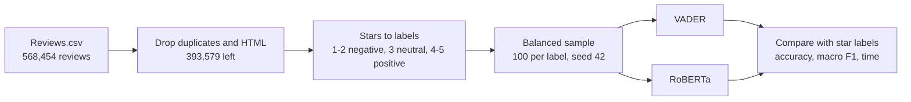
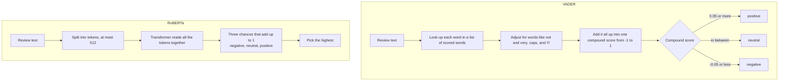
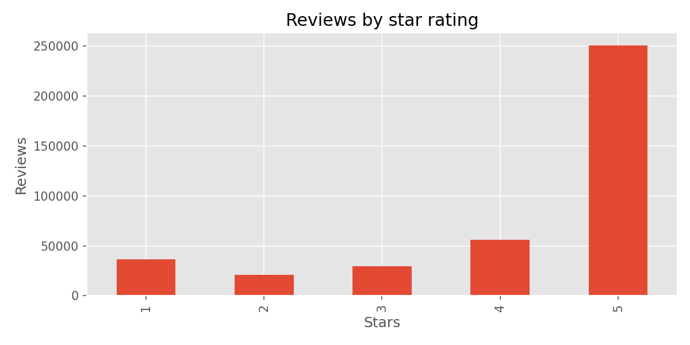
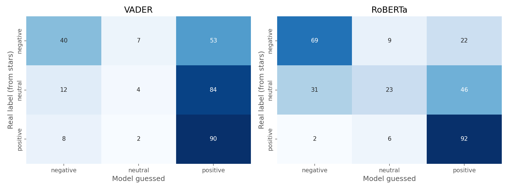
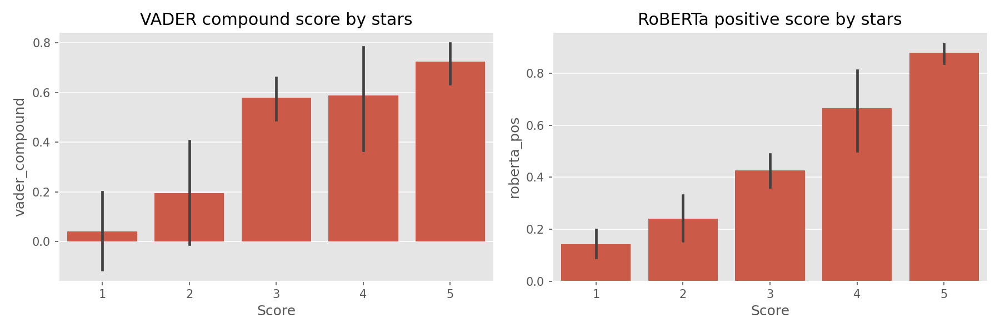

# Amazon review sentiment

I compare two sentiment models on the Amazon Fine Food Reviews dataset. VADER is rule based and comes with NLTK. RoBERTa is a transformer model from Hugging Face, `cardiffnlp/twitter-roberta-base-sentiment`.

The star rating is the answer key. One or two stars counts as negative, three counts as neutral, and four or five counts as positive. The test set has 100 reviews per label. For each model I check accuracy, macro F1, and the average time per review.

## How it works

## How each model decides

## Results

I ran both models on a Kaggle CPU on the same 300 reviews. Random guessing would get about 33%.

| Model | Accuracy | Macro F1 | Seconds per review |
|---|---|---|---|
| VADER | 44.7% | 0.37 | 0.001 |
| RoBERTa | 61.3% | 0.57 | 0.21 |

RoBERTa is more accurate. VADER is about 200 times faster.

### Most reviews are 5 stars

After removing duplicates, 393,579 reviews are left and about 78% of them are positive. That is why the test set takes the same number of reviews from each label.

### Where each model gets confused

Rows are the real label from the stars and columns are what the model guessed. VADER calls most reviews positive, including 53 of the 100 negative ones. RoBERTa gets 69 of the negative ones right. Both models get neutral wrong most of the time.

### Scores by star rating

RoBERTa's positive score goes up steadily from 1 star to 5 stars. VADER gives 3 star and 4 star reviews almost the same score, so it can't tell neutral apart from positive.

### Sarcasm

Both models called "Oh great, another bag of stale chips. Just what I wanted." positive.

## Running it

The notebook is `notebooks/vader_vs_roberta.ipynb` and it runs online.

On Kaggle import the notebook, add the Amazon Fine Food Reviews dataset with Add Input, turn on Internet in the settings, and run all cells.

On Colab open the notebook from GitHub and run all cells. It downloads the dataset into the Colab session by itself.

[Open in Colab](https://colab.research.google.com/github/danish-puri/amazon-review-sentiment/blob/main/notebooks/vader_vs_roberta.ipynb).

add Claude, GPT, and Gemini API and compare all five models on accuracy, cost, and speed.

## Sources
- [Amazon Fine Food Reviews dataset](https://www.kaggle.com/datasets/snap/amazon-fine-food-reviews)
